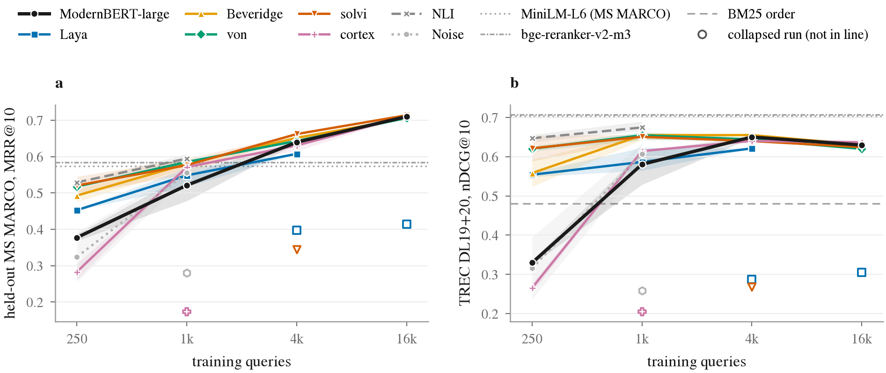
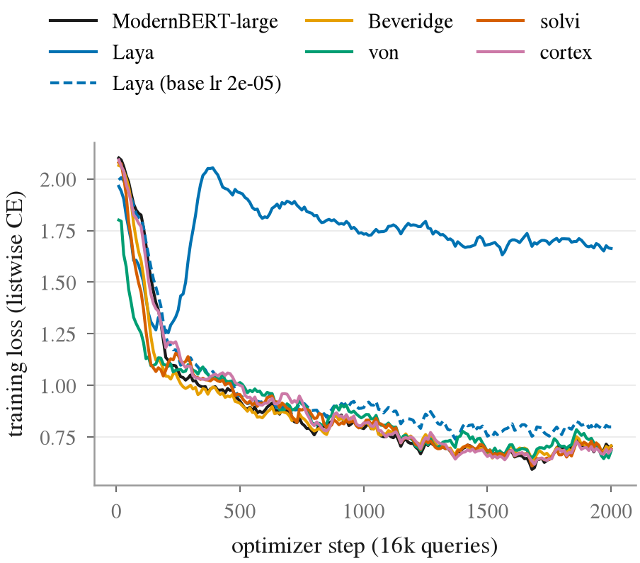
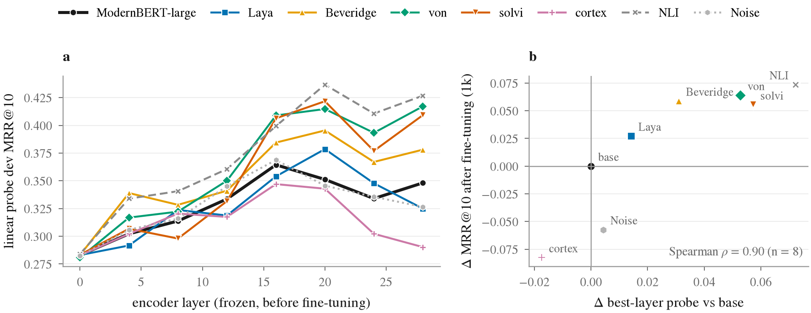

<div align="center">

# arbiter

**Decision models as starting points for cross-encoder rerankers: a preregistered study**

Nikhil Y N · Mohamed Qurrain Shayeeb · Prithvi K M · Praneel S<br>
<sub>Department of Computer Science and Engineering, Ramaiah Institute of Technology, Bengaluru</sub>

[paper (journal)](paper/journal/journal_main.pdf) · [paper (conference)](paper/conference/conf_main.pdf) · [demo video](video/arbiter_demo.mp4) · MIT

</div>

---

Five public decision models are built on ModernBERT-large. Does starting reranker training from one of them beat starting from the plain encoder?

We fine-tune 8 starting points with one recipe on 250 to 16k MS MARCO queries:

- plain ModernBERT-large
- 5 decision checkpoints
- an NLI checkpoint
- a noise-perturbed copy of the encoder

Each starting point gets its own learning-rate search and several seeds. The analysis was frozen in a git tag before any confirmatory run, and test scores stayed sealed until training ended.

| | finding |
|---|---|
| preregistered | **inconclusive**: +0.025 MRR@10 at 1k queries, 95% CI [−0.052, +0.101] |
| why | 5 of 59 runs collapsed, all from non-base checkpoints at higher learning rates |
| without collapses (exploratory) | **a head start that fades**: +0.03 to +0.05 at 1k queries, ≈0 at 16k |
| specificity | an NLI checkpoint gives more; random noise recovers about two-thirds |
| before training | a frozen probe tracks the fine-tuned gain (ρ = 0.90, 8 starting points) |

<p align="center">
  <br>
  <sub>The others start well ahead of plain ModernBERT, then everyone converges. Hollow points are collapsed runs.</sub>
</p>

<p align="center">
  
  <br>
  <sub>Left: a collapse (Laya at its selected rate) next to normal training. Right: frozen probes predict the gain.</sub>
</p>

## quickstart

```bash
uv sync
uv run pytest                                                     # 24 tests, metrics checked against ir_measures
uv run arbiter --config configs/demo.yaml run grid                # one real training run, about a minute on one gpu
uv run arbiter --config configs/demo.yaml rerank examples/tides.txt
uv run arbiter summary                                            # headline numbers from results/stats.json
```

## full study

```bash
uv run arbiter prepare               # held-out splits, bm25 candidates, noise arm
uv run arbiter run all               # grid → select → main → extra (resumable)
uv run arbiter collect --confirmatory
uv run arbiter analyze && uv run arbiter plot
```

Everything about the study lives in `configs/study.yaml`.

- `arbiter run` refuses to start on uncommitted code, skips finished runs and resumes interrupted ones.
- Test scores are sealed until `collect --confirmatory`.
- The 95 runs took 4.1 GPU-hours on one RTX 3090.

<details>
<summary><b>checkpoints and data</b></summary>

<br>

Checkpoints go in `models/<dir>`, data in `data/` (both gitignored).

| dir | hugging face repo | revision |
|---|---|---|
| `ModernBERT-large` | answerdotai/ModernBERT-large | `45bb4654a4d5aaff24dd11d4781fa46d39bf8c13` |
| `laya-en` | convaiinnovations/laya (subfolder laya-en) | `fd4f9dbcf4fde222fd43174bdd4c3b08b789e4e1` |
| `Beveridge-Large-C` | sathiskumarjothi0/Beveridge-Large-C | `7cb0d24cce8572b8803a738c083b2419cdc40a8a` |
| `von` | mohdvasim/von | `8d072bdeb53523a1892d1382406e21c21c56fbda` |
| `solvi-large` | solvi-ai/solvi-large | `cd992673d838761c669611e2f59ba9661d7b1a15` |
| `cortex-1-large` | mukti-sys/cortex-1-large | `3fe2c0b1f997a82339dd13598759abee96495b6d` |
| `ModernBERT-large-nli` | tasksource/ModernBERT-large-nli | `ca476cb923a8637073d4ceb0f19f7fc236e260d4` |
| `minilm` | cross-encoder/ms-marco-MiniLM-L6-v2 | `233902d25c440f23af6f7d6e94d2946bac0bee0a` |
| `bge-v2-m3` | BAAI/bge-reranker-v2-m3 | `953dc6f6f85a1b2dbfca4c34a2796e7dde08d41e` |

Data:
- `data/msmarco/msmarco-bm25/triplet-50/` (sentence-transformers/msmarco-bm25, shard 0)
- `data/msmarco/ms_marco/v1.1/` (validation split, used only to exclude overlapping queries)
- `data/trec-dl-2019|2020/` (official `qrels.txt` and `top1000.tsv.gz`)
- `data/<set>/` for scifact, nfcorpus, fiqa and trec-covid (BEIR format)

</details>

<details>
<summary><b>repository layout</b></summary>

<br>

| path | contents |
|---|---|
| `src/arbiter/` | data, training, scoring, stats, plots, cli |
| `runs/` | every run's config, status, training log and scores (no weights) |
| `results/` | per-query metrics, `stats.json`, tables |
| `figures/` | all figures, pdf and png |
| `paper/` | IEEE journal and conference versions (build with `tectonic -X compile`) |
| `video/` | demo video and talk track |

</details>

**Preregistration.** Tag `prereg-v1` freezes the config and analysis code before any confirmatory run. `prereg-v1.1` records amendment 1. Later changes are listed in the paper.
